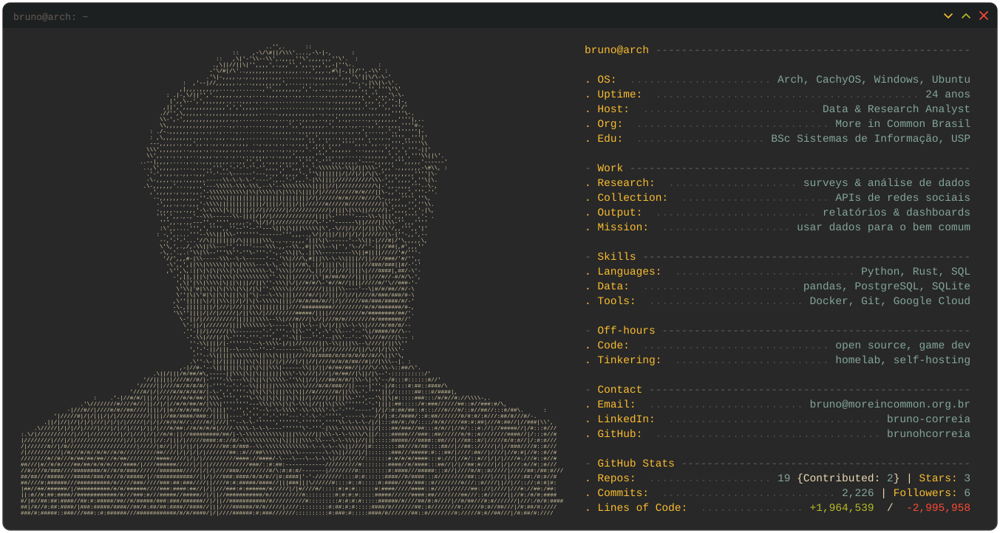

<!--
  Este README mostra o card "neofetch" que o today.py gera.
  O <picture> troca entre tema escuro e claro conforme o GitHub do visitante.
  Os números são atualizados sozinhos pelo GitHub Actions (.github/workflows/profile.yml).
-->

<picture>
  <source media="(prefers-color-scheme: dark)"  srcset="./dark_mode.svg">
  <source media="(prefers-color-scheme: light)" srcset="./light_mode.svg">
  
</picture>

